# Referentes Externos de GUI, UI y UX - Benchmark Firplak E-commerce

> [!IMPORTANT]
> **Estrategia Condensada del Segmento**:
> Compendio maestro y unificado del banco de referentes externos (8 pilares internacionales de arquitectura e interacción GUI + benchmarks curados de Awwwards, comercio de nicho e investigación académica UX de Nielsen Norman Group) seleccionados para guiar las decisiones de diseño en el ecosistema web e-commerce de Firplak. Centraliza patrones de interacción (scroll storytelling, configuradores 3D, megamenús, dirección de arte de lujo, wizards de compra, micro-interacciones, física de movimiento y hegemonía fotográfica) junto con las directrices de arte y producto de la dirección general.

---

## 📌 Tablas Resumen de Referentes Externos

### 1. Pilares de Arquitectura, Interacción y GUI Transaccional

| Referente | URL Oficial | Módulo Destinado en Firplak | Foco GUI / UX Principal |
| :--- | :--- | :--- | :--- |
| **Apple AirPods Pro** | `https://www.apple.com/airpods-pro/` | `pagina_producto.md`, `hidromasajes.md` | Scroll-driven 3D Scrubbing, Despiece interactivo de producto, Micro-callouts flotantes. |
| **Andbro Co** | `https://www.andbro.co/works` | `carpinteria_obra.md`, `sistema_diseno.md` | Retícula editorial minimalista, espacios en blanco, portfolio B2B de arquitectura. |
| **Antonio Lupi** | `https://www.antoniolupi.it/en/home` | `sistema_diseno.md`, `accesorios.md` | Dirección de arte de lujo sanitario italiano, materialidad y texturas de alta gama. |
| **Kohler** | `https://www.kohler.com/en` | `pagina_inicio.md`, `conceptos_catalogo.md` | Arquitectura de Megamenú masivo, navegación B2C/B2B e inspirador por ambiente. |
| **Cowboy E-Bikes** | `https://cowboy.com/` | `mix_and_match.md`, `sistema_diseno.md` | Personalizador 360° en tiempo real, cambio dinámico de acabados y Kinetic Motion UI. |
| **DJI Mavic 3 Pro** | `https://www.dji.com/global/mavic-3-pro` | `hidromasajes.md`, `zona_outdoor.md` | Exposición de ingeniería pesada, fichas técnicas interactivas y visualización de data. |
| **Samsung Galaxy S25 Ultra** | `https://www.samsung.com/us/smartphones/galaxy-s25-ultra/buy/` | `pagina_producto.md`, `pagos_e_integraciones.md` | Wizard de compra por pasos, cálculo dinámico de cuotas/financiamiento y add-ons. |
| **Bullfrog Spas** | `https://www.bullfrogspas.com/design-studio/` | `hidromasajes.md`, `zona_outdoor.md` | Configurador 3D interactivo de jacuzzis/spas, personalización modular de JetPaks, acabados de casco y faldón. |

### 2. Banco Curado Awwwards, Benchmarks de Nicho e Investigación Académica UX

| Referente | URL Oficial | Categoría / Nicho | Foco / Patrón Específico Aplicable a Firplak |
| :--- | :--- | :--- | :--- |
| **Material Kitchen** | `https://materialkitchen.com` | Baños, cocinas y materiales | Megamenú con swatches visibles en miniatura de grilla y propuesta de garantía hero en `cocinas.md`.[^1] |
| **Provider Store** | `https://www.providerstore.com.au` | Baños, cocinas y materiales | Shop by Collection/Brand, umbral de envío repetido en recorrido y hegemonía fotográfica estricta.[^2] |
| **Arteriors Home** | `https://www.arteriorshome.com` | Baños, cocinas y materiales | 4+ ángulos por producto, cotas dimensionales inmediatas en tarjeta y arquitectura de catálogo ultra limpia.[^3] |
| **Bombon (Royal Swedish Candy)** | `https://bombon.rs` | Ecommerce lúdico / experiencial | Navegación por colecciones temáticas con tags rápidos de atributos y dinamismo gráfico 3D.[^4] |
| **Nielsen Norman Group (NN/g)** | `https://www.nngroup.com/articles/ecommerce-product-pages/` | Investigación UX (Académica) | Validación científica de PDP: fotos en contexto > texto, repetición de garantías y prevención de fricción.[^5] |
| **Pear** | `https://pear.no` | Dirección de arte & scroll-scrubbing | Video scroll-scrubbed continuo, tipografía de alto impacto narrativo y loops de descanso de 3-4s.[^6] |

---

## 🎯 Matriz Integral de Aplicación en la Arquitectura de Firplak

```mermaid
graph TD
    A["Referentes Externos de GUI / UI / UX"] --> B["Estética, Materialidad y Fotografía"]
    A --> C["Interacción, 3D y Motion"]
    A --> D["Estructura E-commerce y Catálogo"]
    A --> E["Conversión, Transacción y Confianza"]

    B --> B1["Antonio Lupi: Lujo Sanitario Italiano"]
    B --> B2["Andbro Co: Editorial & Portfolio B2B"]
    B --> B3["Provider Store: Hegemonía Fotográfica"]

    C --> C1["Apple: Scroll 3D Scrubbing & Despiece"]
    C --> C2["Cowboy: Personalizador 360° en Tiempo Real"]
    C --> C3["DJI: Spec Overlays & Data de Ingeniería"]
    C --> C4["Bullfrog Spas: Configurador Modular de Jacuzzis"]
    C --> C5["Pear: Video Scroll Continuo & Loops"]
    C --> C6["Bombon: Dinamismo Gráfico & Micro-animaciones"]

    D --> D1["Kohler: Megamenú Jerárquico & Ambientes"]
    D --> D2["Material Kitchen: Swatches en Grilla & Categorías"]
    D --> D3["Arteriors Home: Arquitectura Limpia & Specs en Tarjeta"]

    E --> E1["Samsung: Wizard de PDP & Financiamiento"]
    E --> E2["NN/g: Heurística Científica de Conversión en PDP"]
```

---

## 📌 Anotaciones de Dirección (Alejandro Isaza)

> [!NOTE]
> Observaciones y directrices clave de Alejandro Isaza para la adopción e implementación de los referentes en Firplak:

1. **Pear ([pear.no](https://pear.no))**:
   - **Scroll sensible y sin fatiga**: El concepto de video continuo es excelente, pero la interacción no debe exigir múltiples scrolls para avanzar ni obligar a un control micrométrico tedioso. Con un scroll sutil debe pasar ágilmente a la siguiente fase.
   - **Video continuo y loops de descanso**: El video debe sentirse continuo y permanente, integrando bucles (loops) de 3–4 segundos al llegar a puntos/hitos clave de la narrativa.
   - **Producción intencional en Higgsfield**: Toda la generación, timing y empalme de estas piezas audiovisuales debe desarrollarse y estructurarse de manera muy intencional en Higgsfield.
2. **Provider Store ([providerstore.com.au](https://www.providerstore.com.au))**:
   - **Hegemonía fotográfica**: Enfoque de fotografía sumamente cuidado y precioso. Es prioritario establecer y mantener una estricta hegemonía visual en el tratamiento fotográfico (iluminación, tonos, encuadres), integrándola como regla fija en los lineamientos de diseño.
3. **Bombon ([bombon.rs](https://bombon.rs))**:
   - **Dinamismo gráfico y 3D**: Destacar no solamente el empleo de elementos tridimensionales, sino también el uso de animaciones gráficas relevantes y expresivas que eleven la interacción sin sobrecargar la experiencia.
4. **Arteriors Home ([arteriorshome.com](https://www.arteriorshome.com))**:
   - **Arquitectura y limpieza estructural**: Es el e-commerce de referencia más notable. Su distribución, orden y arquitectura de sitio están excepcionalmente bien logrados y limpios; rescatar sus patrones estructurales de layout y presentación de catálogo.

---

## 🏛️ PARTE I: Pilares de Arquitectura, GUI e Interacción de Gran Escala

### 1. Apple AirPods Pro (Scroll Storytelling & 3D Interactive Breakdown)

- **URL Oficial**: `https://www.apple.com/airpods-pro/`
- **Categoría GUI**: Scroll-Driven Cinematic Storytelling & Interactive Product Breakdown.

#### Principios Visuales y UI Destacados
1. **Scrubbing Canvas (Secuencia de Fotogramas 3D)**:
   - Avance fotograma a fotograma vinculado al desplazamiento vertical del usuario (`scrollY`).
   - Rotación suave y despiece dinámico del producto (explosionado de componentes).
2. **Tipografía Monumental y Alto Contraste**:
   - Encabezados en gran escala (*display size*) con máxima legibilidad sobre fondo oscuro (`#000000` / `#0B0B0C`).
3. **Hotspots & Micro-callouts Flotantes**:
   - Tarjetas flotantes fijas (*sticky overlay*) que aparecen y desaparecen con transiciones de opacidad y escala según el rango de scroll.
4. **Sub-bar de Navegación Persistente (Sticky Header Bar)**:
   - Header secundario fijo en la parte superior con el nombre del modelo, anclas de sección y botón CTA "Comprar" siempre visible.

#### Aplicación en Firplak
- **PDP de Spas e Hidromasajes (`hidromasajes.md`)**: Animación 3D en scroll que despieza el vaso de hidromasaje, mostrando la estructura reforzada en mármol sintético, motobomba silenciosa, jets de hidromasaje y acometida.
- **PDP de Tinas y Lavamanos (`pagina_producto.md`)**: Comparativa interactiva deslizable que muestra el acabado superficial *Easy Clean* y la resistencia al rayado/manchas.
- **Barra Sticky Fija**: Mantiene visible la línea (ej. *Spa Ibiza 5 Personas*), precio actual y botón "Agregar al Carrito" / "Personalizar".

---

### 2. Andbro Co (Editorial Grid & Portfolio B2B de Arquitectura)

- **URL Oficial**: `https://www.andbro.co/works`
- **Categoría GUI**: Editorial Portfolio & High-End B2B Grid Architecture.

#### Principios Visuales y UI Destacados
1. **Retícula Asimétrica y Espacio Negativo (Whitespace)**:
   - Uso generoso de márgenes y espaciado pasivo que otorga un carácter exclusivo, limpio y altamente profesional.
   - Distribución irregular pero armónica de tarjetas de proyectos, evitando el aspecto cuadriculado rígido tradicional.
2. **Hover State & Image Reveal Sofisticado**:
   - Cursor personalizado interactivo que muestra vistas previas o etiquetas informativas (ej. *Ver Proyecto*, *Materiales Usados*) al pasar sobre cada proyecto.
3. **Tipografía Sans-serif de Alta Densidad Visual**:
   - Uso de tipografías geométricas o neo-grotescas en pesos contrastantes (Ultra Light vs Medium) que comunican precisión arquitectónica.

#### Aplicación en Firplak
- **Carpintería de Obra B2B (`carpinteria_obra.md`)**: Galería de casos de éxito B2B para constructoras (Amarilo, Marval, Bolívar) mostrando cocinas, lavaderos y baños instalados a gran escala.
- **Showrooms e Inspiración (`pagina_inicio.md`)**: Tarjetas interactivas en la Home donde al pasar el cursor se revela la foto real de un espacio amueblado con Firplak.

---

### 3. Antonio Lupi (Lujo Sanitario Italiano & Dirección de Arte)

- **URL Oficial**: `https://www.antoniolupi.it/en/home`
- **Categoría GUI**: High-End Luxury Sanitaryware & Architectural Interior Design.

#### Principios Visuales y UI Destacados
1. **Estética de Lujo Arquitectónico e Interiorismo**:
   - Paleta cromática basada en tonos orgánicos: piedra natural, basalto, arcilla, blanco satén, negro mate y maderas oscuras.
   - Enfoque directo en la escultura del producto (lavamanos independientes, tina exenta, espejos retroiluminados).
2. **Fotografía Inmersiva Full-bleed**:
   - Renderizados y fotografías de arquitectura residencial de vanguardia con iluminación natural dramática y sombras suaves.
3. **Navegación por Materialidad y Colecciones**:
   - Clasificación directa por tipo de material exclusivo, destacando las propiedades de resistencia, higiene y suavidad al tacto.

#### Aplicación en Firplak
- **Storytelling de Materiales (`sistema_diseno.md` & `conceptos_catalogo.md`)**: Bloque dedicado a la tecnología del Mármol Sintético Firplak (textura ultra-suave, no poroso, reparación de rayones) y Quartzstone.
- **Hero Banner Inmersivo (`pagina_inicio.md`)**: Hero de la Home Page con ambientaciones de baño estilo Spa de lujo.
- **Líneas Premium de Baño (`pagina_producto.md` & `accesorios.md`)**: Galería visual donde el lavamanos o la tina es la pieza central del espacio.

---

### 4. Kohler (Megamenú E-commerce & Navegación por Ambiente)

- **URL Oficial**: `https://www.kohler.com/en`
- **Categoría GUI**: Global Kitchen & Bath E-commerce Navigation & Professional Catalog Hierarchy.

#### Principios Visuales y UI Destacados
1. **Megamenú Multinivel Categorizado**:
   - Menú de navegación principal con jerarquía amplia: Categoría Principal -> Subcategoría -> Tipología de Instalación -> Destacados.
   - Inclusión de miniaturas visuales dentro del mismo menú desplegable para guiado rápido del usuario.
2. **Navegación Dual B2C / B2B**:
   - Accesos directos diferenciados para Propietarios de Hogar, Plomeros/Instaladores y Diseñadores/Especificadores Profesionales.
3. **Módulo de Inspiración "Shop the Look"**:
   - Capacidades de exploración por estilos (Moderno, Industrial, Minimalista) con compra directa de todos los elementos del ambiente.

#### Aplicación en Firplak
- **Megamenú Global (`pagina_inicio.md`)**: Menú dividiendo *Baños* (Lavamanos, Muebles, Tinas), *Cocinas*, *Zona de Labores*, *Outdoor/Spas* y *Servicios*.
- **Hub de Instaladores y Repuestos (`servicios.md`)**: Módulo de servicios de Pre-inspección e Instalación Certificada Firplak, agendamiento online y manuales técnicos.
- **Shop the Look (`pagina_inicio.md` & `mix_and_match.md`)**: Galería en la Home para comprar el combo completo de baño (Mueble + Lavamanos + Grifería + Espejo).

---

### 5. Cowboy E-Bikes (Personalizador 360° en Vivo & Motion UI)

- **URL Oficial**: `https://cowboy.com/`
- **Categoría GUI**: Real-Time Product Customizer, Kinetic UI Motion & Interactive Specs.

#### Principios Visuales y UI Destacados
1. **Configurador Dinámico de Producto 360°**:
   - Cambio instantáneo del acabado gráfico del producto en respuesta a la selección del usuario.
   - Renderizado ultrarrápido sin recarga de página ni parpadeos.
2. **Kinetic Micro-Interactions (Motion Physics)**:
   - Animaciones suaves con física de resorte (*spring animations*) al activar o desactivar opciones.
   - Indicadores dinámicos que actualizan el precio total con transiciones numéricas rotativas (*count-up / count-down*).
3. **Selector Flotante de Variantes**:
   - Panel modal/drawer limpio con pill selectors para colores y opciones complementarias.

#### Aplicación en Firplak
- **Visualizador Mix & Match (`mix_and_match.md`)**: Selección en tiempo real del acabado del mueble de madera RH (Duna, Roble, Blanco), tipo de lavamanos y modelo de grifería.
- **Precio Animado Dinámico (`pagina_producto.md` / `mix_and_match.md`)**: Actualización animada del precio acumulado según los componentes agregados al combo.
- **Swatches Interactivos (`sistema_diseno.md`)**: Selectores de color interactivos para lavamanos y muebles con retroalimentación inmediata.

---

### 6. DJI Mavic 3 Pro (Ingeniería Pesada & Fichas Técnicas Complejas)

- **URL Oficial**: `https://www.dji.com/global/mavic-3-pro`
- **Categoría GUI**: Engineering Feature Showcase, Technical Data Visualization & Dark Mode Precision UI.

#### Principios Visuales y UI Destacados
1. **Desglose de Ingeniería Compleja (Tech Spec Overlays)**:
   - Visualización por capas de las características mecánicas y eléctricas pesadas con diagramas vectoriales interactivos.
2. **Estética Dark Mode de Alta Precisión**:
   - Fondo oscuro profundo con acentos de color vibrante (dorado, cyan, blanco puro) para denotar tecnología de vanguardia y durabilidad industrial.
3. **Tabla de Especificaciones Dinámica**:
   - Matriz completa de especificaciones organizadas por pestañas collapsibles (Dimensiones, Acometida Eléctrica, Rendimiento, Garantía).

#### Aplicación en Firplak
- **Desglose de Spas e Hidromasajes (`hidromasajes.md` & `zona_outdoor.md`)**: Capas de refuerzo en mármol sintético, sistema de aislamiento térmico, distribución de tubería hídrica y jets.
- **Ficha de Instalación (`zona_outdoor.md`)**: Tabla collapsible de acometida eléctrica (110V/220V), consumo de agua (litros), resistencia de carga estructural y especificación de acero inoxidable 304.

---

### 7. Samsung Galaxy S25 Ultra (Wizard PDP, Financiamiento & Venta Cruzada)

- **URL Oficial**: `https://www.samsung.com/us/smartphones/galaxy-s25-ultra/buy/`
- **Categoría GUI**: High-Conversion E-commerce Purchase Wizard, Trade-in & Dynamic Financing UI.

#### Principios Visuales y UI Destacados
1. **Step-by-Step Purchase Wizard (Configurador Guiado de Compra)**:
   - Pasos secuenciales integrados dentro de la PDP: 1) Dimensión, 2) Acabado/Color, 3) Servicio Técnico / Garantía, 4) Accesorios Compatibles.
2. **Desglose de Financiamiento Dinámico**:
   - Muestra instantánea del valor total de contado vs pago a cuotas mensuales en tiempo real (ej. *Desde $120.000/mes con ADDI*).
3. **Barra Fija Inferior / Lateral de Resumen (Sticky Drawer)**:
   - Resumen en vivo de la configuración seleccionada con desglose de descuentos, precio final y CTA claro "Comprar Ahora" / "Agregar al Carrito".

#### Aplicación en Firplak
- **Wizard Comercial PDP (`pagina_producto.md`)**: Seleccionar tamaño de lavamanos/mueble -> Elegir acabado de madera/color -> Añadir kit de grifería compatible -> Añadir Servicio de Instalación Certificada.
- **Simulador de Crédito (`pagos_e_integraciones.md`)**: Cálculo transparente de cuotas mensuales (ADDI, ePayco, PSE) en la PDP.
- **Cross-selling de Accesorios (`accesorios.md` & `griferia_plomeria.md`)**: Checkbox interactivo en la PDP para agregar el desagüe/sifón y la grifería adecuada antes de finalizar la compra.

---

### 8. Bullfrog Spas (Configurador 3D Modular de Spas, Casco y JetPaks)

- **URL Oficial**: `https://www.bullfrogspas.com/design-studio/`
- **Categoría GUI**: Modular 3D Spa Configurator, Component Swapping & Luxury Outdoor Customizer.

#### Principios Visuales y UI Destacados
1. **Configurador 3D Interactivo por Capas (Design Studio)**:
   - Personalización paso a paso: serie/tamaño del spa -> acabado del casco acrílico -> material del faldón exterior -> selección de iluminación y audio.
2. **Sistema Modular Intercambiable (JetPak Therapy System)**:
   - Configuración visual interactiva donde el usuario puede arrastrar y posicionar módulos de hidromasaje específicos en cada asiento del jacuzzi.
3. **Resumen Dinámico de Especificaciones y Cotización Directa**:
   - Resumen en tiempo real de dimensiones, capacidad de personas, galones de agua, requerimientos eléctricos y generación de cotización / contacto con distribuidor.

#### Aplicación en Firplak
- **Configurador de Spas y Jacuzzis (`hidromasajes.md` & `zona_outdoor.md`)**: Configuración interactiva del modelo de spa Firplak, permitiendo al cliente seleccionar el color del casco (mármol sintético / acrílico), tipo de faldón exterior (WPC / madera sintética), cantidad/tipo de jets y accesorios (calentador, cromoterapia, cobertor térmico).
- **Cálculo de Acometida en Vivo**: Validación instantánea de los requisitos eléctricos (110V vs 220V GFCI) y de soporte estructural según la configuración seleccionada.

---

## 🎨 PARTE II: Banco Curado Awwwards, Benchmarks de Nicho e Investigación UX

### 🛁 Baños, cocinas y materiales

- [Material Kitchen](https://materialkitchen.com)[^1]
- [Provider Store](https://www.providerstore.com.au)[^2]
- [Arteriors Home](https://www.arteriorshome.com)[^3]

### 🍬 Ecommerce lúdico / experiencial

- [Bombon — Royal Swedish Candy](https://bombon.rs)[^4]

### 📚 Investigación UX (fuente académica, no comercial)

- [Nielsen Norman Group — Ecommerce Product Pages](https://www.nngroup.com/articles/ecommerce-product-pages/)[^5]

### 🎬 Dirección de arte y scroll-scrubbing

- [Pear](https://pear.no)[^6]

---

## 📝 Notas al Pie y Especificaciones de Patrones Aplicables

[^1]: **Material Kitchen**: Mega-menú jerárquico por tipo de producto (Prepware, Knives, Sets, Tools, Tabletop...) con swatch de color visible directamente en la miniatura de la grilla (ej. "Cool Neutral"), sin esperar al PDP. La garantía ("guaranteed for life") se comunica como propuesta de valor en el hero, no como letra chica. Aplicable a cocinas: exponer acabado/material como filtro visual en la grilla de [cocinas.md](cocinas.md), no solo como atributo de ficha técnica.

[^2]: **Provider Store**: Combina "Shop by Collection" y "Shop by Brand" para navegar 151 productos en 13+ categorías sin saturar. El umbral de envío gratis se repite desde el carrito vacío con mensaje de reaseguro, en vez de aparecer recién en el checkout. Aplicable a la política de envíos documentada en [recomendaciones_pagos_y_productos.md](recomendaciones_pagos_y_productos.md): repetir el umbral/condición de envío en más puntos del recorrido, no solo en el paso final.
  > **Comentario Alejandro Isaza**: Enfoque fotográfico de referencia. Mantener una hegemonía fotográfica estricta e incorporarla a los lineamientos de diseño.

[^3]: **Arteriors Home**: Cada producto muestra 4+ ángulos (foto general, detalle, swatch de color) junto con specs dimensionales inmediatas (ej. "Dia: 52 in H: 28.5 in") y el SKU, directamente en la tarjeta de producto — reduce devoluciones por expectativa equivocada de tamaño/acabado, exactamente el riesgo que documenta la nota [^5] de NN/g. Badges de "Ships Free" y devolución a 30 días también viven en la tarjeta, no solo en el PDP.
  > **Comentario Alejandro Isaza**: Es el e-commerce más notable del grupo. Arquitectura y distribución sumamente limpias y bien logradas; rescatar sus elementos de organización.

[^4]: **Bombon**: Organiza el catálogo por "colecciones-mundo" temáticas (Sugar Rush, Sour Power, Cocoa Bliss, Licorizz) en lugar de categorías de producto, con tags escaneables de atributos (sin gluten, ácido, chocolate) debajo de cada nombre. Patrón trasladable a variantes técnicas de grifería/hidromasaje — mostrar atributos como "ahorro hídrico", "cartucho cerámico" o "apto exterior" como tags rápidos en la grilla de [griferia_plomeria.md](griferia_plomeria.md) y [zona_outdoor.md](zona_outdoor.md), no solo en la tabla de especificaciones.
  > **Comentario Alejandro Isaza**: Destacar el uso combinado de elementos 3D y animaciones gráficas relevantes.

[^5]: **Nielsen Norman Group**: Fuente de investigación, no un sitio comercial. Con estudios de usuarios reales confirma que: (a) las fotos en contexto/detalle pesan más que la descripción textual al decidir una compra — un participante eligió un producto solo por las fotos del interior, sin leer texto; (b) la información de envío/garantía debe repetirse en el PDP, no solo en el checkout (compara el caso de Casper, que la muestra arriba, contra un competidor que la enterró); (c) la confirmación visual al añadir al carrito evita pedidos duplicados y carritos abandonados. Respalda con evidencia externa varias decisiones ya tomadas en [pagina_producto.md](pagina_producto.md) y [recomendaciones_pagos_y_productos.md](recomendaciones_pagos_y_productos.md) (consultar directrices completas en [skills/nng-ecommerce-pdp.md](../../skills/nng-ecommerce-pdp.md)).

[^6]: **Pear**: Sitio de la growth studio noruega Pear (Honorable Mention en Awwwards, nota jurado hasta 9.9/10): describe su propia estética como "un prospecto en letterpress" — tipografía ornamental "mal registrada" (efecto halftone desalineado a propósito) sobre pinturas neoclásicas, con una **pieza de video renacentista scroll-scrubbed** (el scroll controla el playback frame a frame, no autoplay). Es la validación externa más directa de la técnica que [sistema_diseno.md](sistema_diseno.md) ya define como motor oficial de scroll-scrubbing (GSAP + Canvas 2D + Lenis): confirma que el mismo patrón funciona igual de bien con video real que con secuencias de frames renderizadas, y que la tipografía puede cargar tanto peso narrativo como la imagen. Además, la home resuelve las objeciones de venta ("¿cuánto cuesta?", "¿por qué este modelo?") antes que las features — un orden de información trasladable al embudo consultivo de [carpinteria_obra.md](carpinteria_obra.md), que hoy abre con el proyecto y no con la objeción de precio/plazo.
  > **Comentario Alejandro Isaza**: El video continuo debe avanzar de fase con un scroll sutil (sin fatiga de scroll múltiple) y mantener loops de descanso de 3-4s en puntos clave; debe desarrollarse de forma intencional en Higgsfield.
