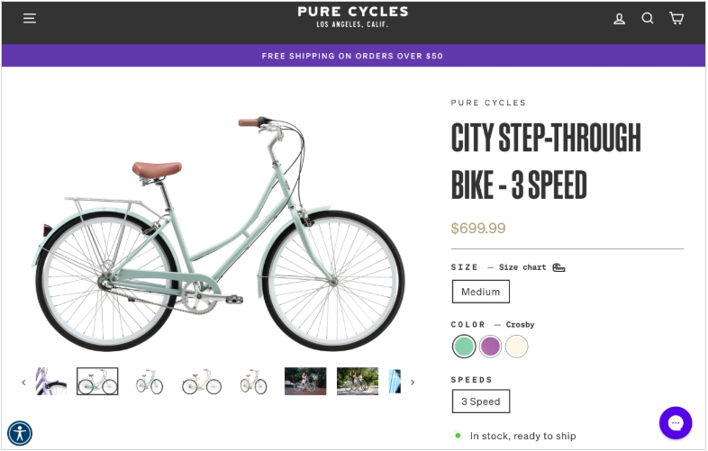
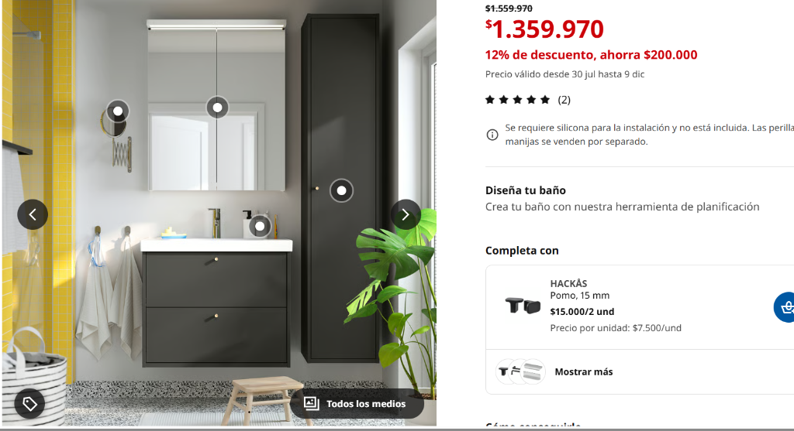
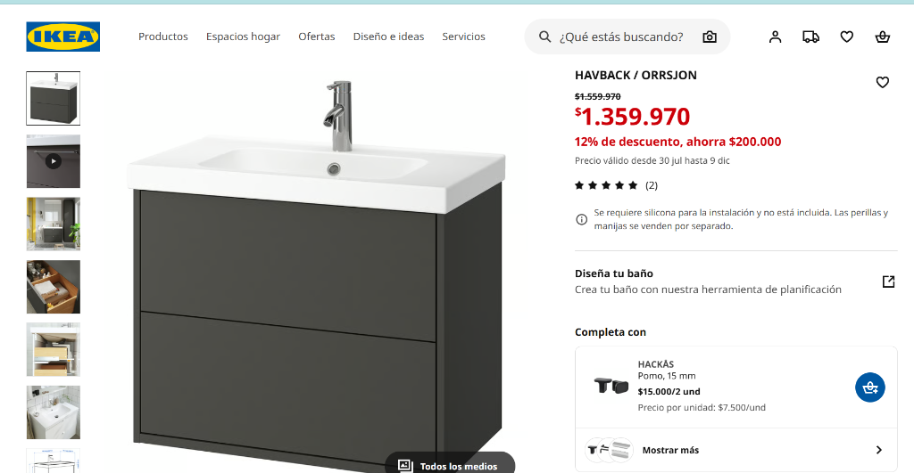
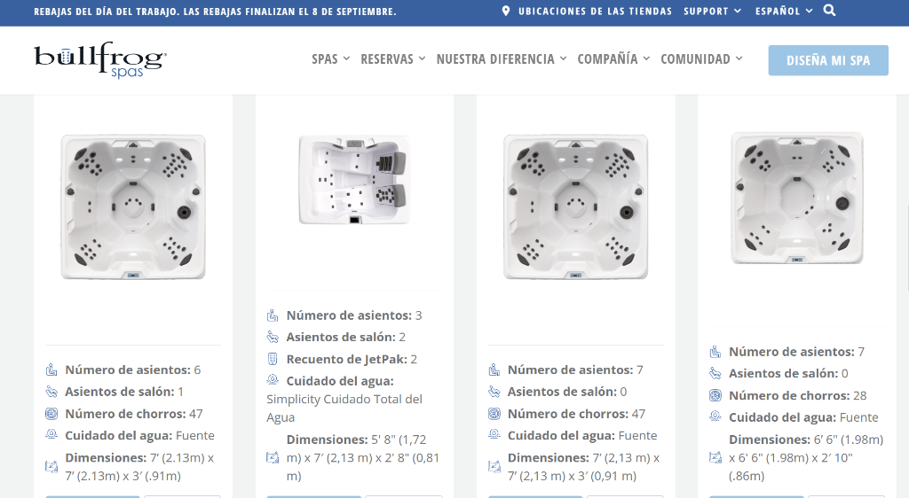

# Referentes Externos & Benchmark UX/UI para Firplak E-Commerce

Este documento compila el análisis de mejores prácticas de comercio electrónico global y diseño de experiencia de usuario (UX/UI) extraídas de líderes de la industria (IKEA, Pure Cycles, Bullfrog Spas, Hot Spring, Jacuzzi, Tonal, Apple, Sundance, Caldera, Hydropool y Aquavia Spa). Su objetivo es orientar las decisiones de arquitectura de información, diseño visual y flujos de conversión de la nueva tienda online de **FIRPLAK**.

---

## 🧭 1. Visión Macro de Navegación: Los Dos Grandes Universos

Para maximizar la conversión y simplificar la carga cognitiva del usuario, la plataforma digital de Firplak debe estructurarse desde el nivel superior en dos grandes categorías o pestañas maestras con propuestas de valor, arquetipos de cliente y journeys de compra diferenciados:

```
                  ┌─────────────────────────────────────────────────────┐
                  │              FIRPLAK E-COMMERCE HUB                 │
                  └──────────────────────────┬──────────────────────────┘
                                             │
                  ┌──────────────────────────┴──────────────────────────┐
                  │                                                     │
┌─────────────────▼──────────────────┐               ┌──────────────────▼─────────────────┐
│     🌿 BIENESTAR / WELLNESS        │               │   🏠 MEJORAMIENTO DEL HOGAR        │
│  (Alta Consideración & Deseo)      │               │     (Compra Ágil & Modular)        │
├────────────────────────────────────┤               ├────────────────────────────────────┤
│ • Jacuzzis & Spas Exteriores       │               │ • Baños (Muebles, Lavamanos, etc.) │
│ • Tinas de Hidromasaje             │               │ • Cocinas (Mesones, Lavaplatos)    │
│ • Bañeras de Inmersión             │               │ • Zona de Ropas (Lavaderos)        │
│ • Saunas & Cabinas                 │               │ • Griferías & Accesorios           │
├────────────────────────────────────┤               ├────────────────────────────────────┤
│ Funnel: Asistido, Emocional,       │               │ Funnel: Transaccional, Visual,     │
│ Terapias, Spa Match, Validación    │               │ Above the Fold, Mix & Match,       │
│ de Espacio y Asesoría Técnica      │               │ Shoppable Images, Venta Cruzada    │
└────────────────────────────────────┘               └────────────────────────────────────┘
```

> [!IMPORTANT]
> **Separación de Intenciones:** Quien busca un jacuzzi para su terraza o casa campestre está en un proceso de investigación de alta consideración, enfocado en bienestar, relajación familiar y viabilidad de instalación. Quien busca renovar el mueble del baño o el lavadero de ropas busca dimensiones exactas, compatibilidad estética, entrega ágil y un proceso de compra directo sin fricciones.

---

## 🏠 2. Categorías de Mejoramiento del Hogar (Baños, Cocinas, Ropas)

Para las categorías transaccionales de mobiliario y aparatos sanitarios, el diseño debe priorizar la **reducción del esfuerzo cognitivo**, la **visualización ambiental** y la **venta cruzada inmediata**.

### 2.1. "Agregar al Carrito" Inmediato Sin Scroll (Above the Fold)

* **Referente Inspirador:** **Pure Cycles** (PDP de bicicletas y movilidad).



#### Insights Clave de Pure Cycles
1. **Compresión Vertical del Hero:** La galería del producto a la izquierda convive perfectamente a la misma altura con el panel de decisión de compra a la derecha.
2. **Jerarquía Visual Ininterrumpida:** Nombre del producto, precio en tipografía de alto impacto, selectores rápidos de talla/medida, selector de color con swatches interactivos y botón de compra primario están 100% visibles en el primer viewport (pantalla inicial) sin necesidad de hacer ningún scroll.
3. **Indicadores de Disponibilidad en Vivo:** Leyenda destacada con punto verde: *"In stock, ready to ship"*, reduciendo la duda sobre tiempos de entrega antes del clic.

#### Aplicación en Firplak (Baños, Cocinas y Ropas)
* **Eliminación del Scroll Forzado:** En muebles de baño (ej. Trento, Turín, Praga), lavamanos y lavaderos, el selector de medida (45 cm, 60 cm, 80 cm, 100 cm), el color/acabado (Humo, Chantillí, Cenizo, Roble) y el botón **"Añadir al Carrito"** / **"Comprar Ahora"** deben caber por completo en el primer golpe de vista en desktop.
* **Sticky CTA en Mobile:** En dispositivos móviles, si el usuario scrollea para leer la descripción técnica o ver fotos de detalle, se fija automáticamente una barra inferior (*sticky bottom bar*) con miniatura, precio actual y botón de compra rápido.

---

### 2.2. Venta Cruzada a Través de la Imagen (Shoppable Scenes / Hotspots Interactivos)

* **Referente Inspirador:** **IKEA** (Ambientes de Baño y Escenas Completas).



#### Insights Clave de IKEA
1. **Pines Interactivos (Hotspots) en Escena:** En la galería de fotos del producto ambientado, la imagen incluye puntos interactivos circulares colocados sobre cada elemento del baño (mueble bajo, lavamanos, grifería, espejo con iluminación, gabinete auxiliar alto, canasta toallero).
2. **Contexto Arquitectónico Real:** El usuario no ve un mueble aislado en fondo blanco; ve cómo combina el mueble con el piso de terrazo, el espejo vertical y la grifería de diseño.
3. **Exploración Sin Salir del Flujo:** Al tocar un pin, se despliega una pequeña tarjeta flotante con nombre del producto, referencia, precio y opción de agregar al carrito o abrir en pestaña nueva.

#### Aplicación en Firplak
* **"Compra el Ambiente Completo":** Implementar escenas fotográficas interactivas donde los clientes que compran un mueble de baño puedan hacer clic en el lavamanos de sobreponer, el espejo biselado LED, el gabinete superior y la grifería monocontrol que aparecen en la fotografía oficial de catálogo.
* **Aumento del Ticket Promedio (AOV):** Permite transformar la venta de un mueble de $400.000 COP en un paquete de renovación de baño de $1.200.000 COP de forma natural e inspiracional.

---

### 2.3. Bloque Integrado "Completa con..." (Cross-Selling de Accesorios Indispensables)

* **Referente Inspirador:** **IKEA PDP** (`HAVBACK / ORRSJON`).



#### Insights Clave de IKEA
1. **Ubicación Estratégica:** Ubicado justo debajo del precio y de la herramienta de diseño del espacio.
2. **Accesorios que Evitan Dolores de Cabeza:** Muestra inmediatamente insumos indispensables que no vienen incluidos con el mueble base pero son obligatorios para el ensamble (ej. manijas/tiradores, pomos, silicona de sellado sanitario, patas regulables).
3. **Acción en 1 Clic:** Botón directo circular de carrito `[+]` para agregar el insumo complementario sin abrir otra página.

#### Aplicación en Firplak
* **Kit de Instalación Recomendado:**
  * **En Muebles de Baño:** Sugerir pomos/tiradores opcionales, sifón corrugado antiolores, desagüe push cromado/negro y silicona antihongos de alta adherencia.
  * **En Lavaplatos / Cocinas:** Sugerir grifería flexible/extensible, canastilla sifonada de 4 pulgadas y dispensador de jabón empotrable.
  * **En Lavaderos de Ropa:** Sugerir base metálica estructural con pintura electrostática, sifón de descarga rápida y grifo lavadero cromado.

---

### 2.4. Asistente IA Contextual: Chat Proactivo con Autoescritura ("¿Me cabe este mueble?")

* **Concepto UX:** Transformar el típico botón estático de chat en una **burbuja inteligente contextual y proactiva** que simula autoescritura de dudas comunes basadas en el producto específico que se está visualizando.

```
┌─────────────────────────────────────────────────────────────┐
│ 💬 Asistente Virtual Firplak                        [ – ] [x]│
├─────────────────────────────────────────────────────────────┤
│ 👋 ¡Hola! Veo que estás revisando el Mueble Trento 80 cm.  │
│                                                             │
│ 💡 Preguntas frecuentes sobre este producto:                │
│ ┌─────────────────────────────────────────────────────────┐ │
│ │ ⚡ "¿Me cabe este mueble si mi baño mide 1.50 x 2.00 m?" │ │
│ └─────────────────────────────────────────────────────────┘ │
│ ┌─────────────────────────────────────────────────────────┐ │
│ │ ⚡ "¿Qué grifería le queda perfecta a este lavamanos?"  │ │
│ └─────────────────────────────────────────────────────────┘ │
│ ┌─────────────────────────────────────────────────────────┐ │
│ │ ⚡ "¿El aglomerado RH resiste la humedad de la ducha?"   │ │
│ └─────────────────────────────────────────────────────────┘ │
│                                                             │
│ O escribe tu pregunta aquí...                               │
│ [ Escribe tus medidas o dudas de espacio...        ] [Enviar]│
└─────────────────────────────────────────────────────────────┘
```

#### Características Clave
1. **Chips de Preguntas Frecuentes Auto-sugeridas:** Al entrar a la página del producto, el widget muestra preguntas frecuentes como *"¿Me cabe este mueble en mi baño?"* o *"¿Viene armado o desarmado?"* mediante una suave animación de escritura (*typewriter effect*).
2. **Resolución Inmediata de Objeciones Espaciales:** Si el usuario hace clic en *"¿Me cabe este mueble?"*, el bot le pide: *"Ingresa el ancho de tu pared o envía una foto"* y calcula al instante si deja suficiente espacio libre para el paso y el inodoro según normas ergonómicas.
3. **Sin Fricción Humana Inicial:** Da respuestas técnicas inmediatas apoyadas en la base de conocimiento y fichas de Firplak; si la consulta requiere un asesor comercial o arquitecto, transfiere fluidamente a WhatsApp.

---

## 🌿 3. Sección de Hidromasajes & Wellness (Alta Consideración)

Los hidromasajes, jacuzzis y tinas no son compras por impulso. Son productos de alta inversión ($5M a $30M+ COP) donde la mayor barrera de compra no es el precio, sino la **ansiedad técnica** (*"¿Me cabe?", "¿El piso resistirá el peso lleno?", "¿Tengo la luz necesaria?", "¿Cómo lo suben a un piso 4?"*).

### 3.1. Menú Horizontal Especializado (Inspiración Bullfrog Spas)

* **Referente:** **Bullfrog Spas** ([https://www.bullfrogspas.com/es/](https://www.bullfrogspas.com/es/)).

Al ingresar a la pestaña o portal **Bienestar / Wellness**, la barra de navegación se transforma en un submenú temático especializado que educa, inspira y reduce el miedo técnico:

```
┌───────────────────────────────────────────────────────────────────────────────────────────────────────────┐
│                                       FIRPLAK WELLNESS COLLECTION                                         │
├──────────────┬──────────────────┬─────────────────┬────────────────────┬─────────────────┬────────────────┤
│ 1. ¿POR QUÉ  │ 2. TERAPIAS &    │ 3. SISTEMAS DE  │ 4. ENCUENTRA TU    │ 5. PREPARACIÓN  │ 6. RESPALDO &  │
│  FIRPLAK?    │    BENEFICIOS    │    MASAJE & JETS│    JACUZZI (TEST)  │    TÉCNICA      │    GARANTÍA    │
└──────────────┴──────────────────┴─────────────────┴────────────────────┴─────────────────┴────────────────┘
```

#### Desglose de Cada Módulo del Menú
1. **¿Por qué Firplak Jacuzzis?**:
   * Más de 40 años de liderazgo e innovación en Colombia.
   * Acrílico sanitario reforzado con fibra de vidrio de alta densidad (no se mancha, fácil limpieza, brillo duradero).
   * Motobombas de bajo consumo y aislamiento acústico.
2. **Terapias & Beneficios**:
   * Alivio de tensiones lumbares y cervicales (fisioterapia).
   * Estimulación de la circulación y drenaje linfático.
   * Ritual de desconexión mental y combate del insomnio.
   * Cromoterapia LED (efecto restaurador de la luz y el color).
3. **Sistemas de Masaje & Jets (Equipamiento)**:
   * Demostración interactiva de boquillas de agua (hidromasaje) vs burbujas de aire (aeromasaje).
   * Equipamientos disponibles: Estándar, Confort, Confort Plus, Lujo/Total Spa.
4. **Encuentra tu Jacuzzi Ideal (Spa Match Test)**:
   * Test guiado de 3 minutos para recomendar el modelo y equipamiento exacto.
5. **Preparación Técnica & Instalación**:
   * Checklist paso a paso: Acometida eléctrica (110V vs 220V), losa de soporte (peso lleno de agua + personas), puntos hidráulicos y accesos físicos (puertas, escaleras, grúa).
6. **Respaldo, Garantía & Servicio**:
   * Red nacional de técnicos certificados Firplak.
   * Repuestos originales garantizados y asesoría de postventa directa de fábrica.

---

### 3.2. Navegación por Estilo de Vida y Emociones (No Solo Códigos de Producto)

> *"No estás comprando un jacuzzi. Estás diseñando dónde terminará tu día."*

El error común en sitios tradicionales de jacuzzis es clasificar el catálogo por nombres internos o número de serie (ej. "Línea 400 vs Línea 800"). Los referentes mundiales (Sundance, Hot Spring, Bullfrog) demuestran que el cliente navega por **propósito de vida**:

| Ruta de Navegación | Arquetipo de Usuario | Foco del Mensaje | Modelos Firplak Sugeridos |
| :--- | :--- | :--- | :--- |
| **"Para Dos" (Parejas & Romance)** | Parejas, suites principales, apartamentos con terraza. | Intimidad, desconexión, tumbonas dobles ergonómicas. | Jacuzzis de 2 puestos, Tinas de hidromasaje. |
| **"Familiar & Hogar"** | Familias con hijos, casas campestres. | Espacio amplio, asientos multinivel, seguridad y entretenimiento. | Jacuzzis de 4 a 6 personas. |
| **"Recovery & Deportivo"** | Atletas, runners, crossfit, entusiastas del fitness. | Hidroterapia de impacto, alivio muscular profundo, contraste térmico. | Modelos con jets lumbares potentes y calentador rápido. |
| **"After-Work & Relax"** | Profesionales con alto estrés laboral. | Silencio, aromaterapia, cromoterapia suave, relajación de hombros y cuello. | Spas con kits de relajación y microjets cervicales. |
| **"Espacios Reducidos & Balcones"** | Terrazas urbanas y áreas restringidas. | Eficiencia dimensional, fácil paso por puertas, bajo peso volumétrico. | Tinas empotradas compactas y spas rectangulares optimizados. |

---

### 3.3. El "Spa Match Test" (Quiz Interactivo de Decisión)

Inspirado en los mejores selectores de la industria (*Apple Mac Matcher*, *Master Spas Quiz*, *Hydropool Learning Guide*), este recomendador no debe ser un formulario aburrido para capturar datos, sino una herramienta de consultoría interactiva:

```
[ PASO 1: PROPÓSITO ] ──► [ PASO 2: PERSONAS ] ──► [ PASO 3: ESPACIO ] ──► [ PASO 4: TÉCNICA ] ──► [ RESULTADO MATCH ]
  • Relax & Pareja           • 1-2 personas          • Jardín / Finca          • Tengo 220V           ⭐ Jacuzzi Recomendado
  • Familia & Hijos          • 3-4 personas          • Terraza / Balcón        • Solo tengo 110V      📊 Spa Readiness: 92%
  • Terapia Deportiva        • 5+ personas           • Baño Principal          • No estoy seguro      📋 Requisitos de Obra
```

#### Los 7 Bloques del Spa Match Test
1. **Emocional:** ¿Cuál es la principal experiencia que sueñas vivir?
2. **Humano:** ¿Cuántas personas lo utilizarán simultáneamente con mayor frecuencia?
3. **Espacial:** ¿Dónde se ubicará? (Jardín sobre tierra, terraza en azotea, deck de madera, cuarto de baño).
4. **Accesibilidad:** ¿Por dónde debe ingresar el equipo hasta su lugar final? (Puerta estándar de 80 cm, ventanal, pasillo abierto, requiere izaje con grúa).
5. **Técnico:** ¿Qué tipo de energía eléctrica tienes disponible? (110V normal, 220V bifásico, o "no estoy seguro - requiero asesoría").
6. **Estético:** ¿Prefieres acabado con faldón decorativo tipo madera, faldón acrílico o empotrado en obra civil?
7. **Económico:** ¿Deseas pago de contado o prefieres cuotas mensuales con financiación (ADDI / ePayco)?

#### Resultado del Test: "Spa Readiness Score"
El sistema no solo arroja un modelo de jacuzzi, sino un **informe de compatibilidad**:
* **Tu Match Ideal:** Jacuzzi Firplak Oasis 5 Personas (94% de afinidad).
* **Compatibilidad de Espacio:** ✅ Excelente (cabe holgadamente en tu terraza de 3.0 × 2.5 m).
* **Ruta de Acceso:** ⚠️ *Atención requerida:* el ancho del jacuzzi es de 88 cm; confirma si el vano de tu puerta o escalera permite el giro.
* **Energía Requerida:** 220V Bifásico con interruptor de 40A para el calentador eléctrico.
* **Opciones de Acción:** `[Ver en 3D / Realidad Aumentada]` · `[Agendar Visita Técnica de Validación]` · `[Descargar Ficha Preinstalación]`.

---

### 3.4. Tarjetas de Producto en Feed (PLP) con Especificaciones Clave

* **Referente:** **Bullfrog Spas Feed / Grid de Productos**.



#### Insights Clave de Bullfrog Spas
1. **Vista Cenital Limpia:** La fotografía principal del producto en la grilla es una toma superior ortogonal que permite al usuario comprender de un solo vistazo la cantidad de asientos, la distribución de los jets y la presencia de camas de hidromasaje (*loungers*).
2. **Micro-especificaciones Normalizadas con Iconografía:**
   * 👥 **Número de Asientos:** ej. 3, 6, 7 puestos.
   * 🛋️ **Asientos de Salón / Tumbonas:** ej. 0, 1 o 2 camas reclinables.
   * 🌀 **Número de Chorros / Jets:** ej. 28, 47 chorros de agua.
   * 📐 **Dimensiones:** Medidas exteriores precisas en metros (ej. 2.13 m × 2.13 m × 0.91 m).
   * 💧 **Cuidado del Agua:** Sistema de filtración y purificación (ozonizador, filtro cartucho).

#### Aplicación en el Catálogo de Hidromasajes Firplak
En todas las páginas de categoría de jacuzzis y tinas, cada tarjeta debe incluir este bloque estandarizado de 5 datos esenciales antes del precio. Esto permite al usuario comparar mentalmente las referencias sin tener que abrir 15 pestañas simultáneas.

---

### 3.5. Paradigma de Venta: "Commerce Asistido" vs Add-to-Cart Tradicional

En productos de alta consideración y complejidad física, el modelo tradicional de carrito directo genera abandono o reclamos costosos si el producto llega a la vivienda y no cabe por la puerta o el circuito eléctrico colapsa.

El modelo óptimo para Firplak es el **Commerce Asistido en 4 Pasos**:

```
┌─────────────────┐     ┌─────────────────┐     ┌─────────────────┐     ┌─────────────────┐
│ 1. CONFIGURACIÓN│ ──► │ 2. VALIDACIÓN   │ ──► │ 3. PRECIO &     │ ──► │ 4. RESERVA &    │
│    & PERSONALIZA│     │    DE ESPACIO   │     │    FINANCIACIÓN │     │    INSTALACIÓN  │
│    (Color, Jets)│     │ (Readiness Check│     │ (Desde $X/mes)  │     │ (Visita/Entrega)│
└─────────────────┘     └─────────────────┘     └─────────────────┘     └─────────────────┘
```

1. **Configuración Visual:** El cliente escoge color de la concha acrílica, faldón exterior, número de jets y adiciones (calentador, cromoterapia, blower).
2. **Validación de Espacio ("Installation Readiness"):** Checklist visual de medidas, peso y acometida. Opcional: enviar foto de la terraza por WhatsApp o subir plano para aprobación de ingeniería Firplak.
3. **Claridad Total de Costos:** Mostrar precio base transparente + opción de cuota mensual con ADDI + costo estimado de flete e instalación por separado.
4. **Cierre de Venta Flexible:**
   * Compra online completa con pasarela de pagos segura (ePayco / PSE / Tarjeta de crédito).
   * Reserva con anticipo/depósito para congelar el precio mientras se realiza la visita técnica.
   * Contacto con ejecutivo de proyectos Firplak para clientes institucionales o constructores.

---

## 📊 4. Síntesis del Benchmark Global de E-Commerce para Spas

El documento técnico complementario analizado ([benchmark_global_ecommerce_jacuzzis_ux.pdf](./especificaciones/wiki/assets/benchmark_global_ecommerce_jacuzzis_ux.pdf)) evaluó a los 10 líderes internacionales del sector bajo 10 dimensiones heurísticas de UX/UI (claridad de home, descubrimiento, PDP, visualización 3D/AR, experiencia móvil, checkout/conversión, confianza, soporte, entrega/instalación y garantías):

### Tabla Resumen del Benchmark Heurístico (Sobre 100 Puntos)

| Puesto | Marca / Referente | Score | Lo Mejor para Copiar e Implementar en Firplak |
| :---: | :--- | :---: | :--- |
| **1** | **Hot Spring** | **94 / 100** | Visualizador de Realidad Aumentada (AR) + recorrido 360°, precio visible con mensualidad de financiación estimada y recomendador *"Help Me Choose"*. PDP con peso lleno, voltaje y capacidad de agua. |
| **2** | **Bullfrog Spas** | **92 / 100** | Design Studio para personalización profunda de jets (*JetPaks* intercambiables) y narrativa de bienestar/conexión familiar, en lugar de listas frías de especificaciones. |
| **3** | **Jacuzzi®** | **90 / 100** | Mejor funnel asistido end-to-end: *Build & Price*, rangos de precio por serie, guía de preinstalación descargable, prueba en agua (*wet test*) e inspección física del emplazamiento. |
| **4** | **Caldera Spas** | **88 / 100** | *Vision AR* para colocar el modelo 3D en la terraza del usuario y *Learning Center* ordenado por instalación, seguridad, mantenimiento y costos reales de operación. |
| **5** | **Sundance Spas** | **86 / 100** | Taxonomía de navegación por estilos de vida y motivación (*"Entertaining"*, *"Small Spaces"*, *"Families"*, *"Low Maintenance"*). |
| **6** | **Master Spas** | **84 / 100** | Quiz interactivo *"Find My Spa"*, filtros por tamaño y precio, y recursos visuales de diseño de patio (*Backyard Design*). |
| **7** | **Endless Pools** | **84 / 100** | Gran capacidad para explicar un producto técnicamente intimidante (piscinas modulares contracorriente) en términos sencillos de instalación y estilo de vida. |
| **8** | **Aquavia Spa** | **78 / 100** | Referente europeo de estética y diseño arquitectónico; incorporación de chatbot con IA para orientación y asesoría de navegación. |
| **9** | **Hydropool** | **78 / 100** | Centro educativo excepcional; desmitifica el peso lleno de la tina, la resistencia de losa y las restricciones de instalación sin asustar al comprador. |
| **10** | **Wellis** | **76 / 100** | Diseño europeo sobrio, eficiencia energética comunicada con claridad y fichas de producto bien jerarquizadas. |

### Referentes Analógicos Fuera del Sector Tradicional
* **Apple (Mac):** El estándar de oro para traducir especificaciones técnicas complejas (chips, memoria unificada, GPU) en soluciones para la vida diaria (*"Ideal para edición de video 4K o tareas universitarias"*), acompañado de la herramienta *"Help Me Choose"* y conexión con un especialista.
* **IKEA (Planificadores 3D):** La referencia mundial en venta cruzada contextual, modulación de espacios y listas de empaque completas.
* **Tonal (Gimnasio Inteligente de Pared):** Producto fitness de lujo que requiere validar pared, estructura, altura libre y conexión eléctrica antes de enviar el producto. Su checklist de *"Installation Readiness"* es el modelo perfecto para adaptar al checklist de jacuzzis de Firplak.

---

## 🚀 5. Hoja de Ruta de Implementación para Firplak

Para llevar estos referentes a la realidad operativa del proyecto sin sobrecargar el desarrollo inicial, se propone una hoja de ruta dividida en tres horizontes:

```
┌─────────────────────────────────────────────────────────────────────────────────────────────────────────┐
│                                     ROADMAP DE EXPERIENCIA FIRPLAK                                      │
├───────────────────────────────┬─────────────────────────────────┬───────────────────────────────────────┤
│ FASE 1: MVP (0 a 8 Semanas)   │ FASE 2: CONFIANZA (2 a 4 Meses) │ FASE 3: INTELIGENCIA (4 a 8 Meses)    │
├───────────────────────────────┼─────────────────────────────────┼───────────────────────────────────────┤
│ • Menú dual: Bienestar vs     │ • Spa Match Test v1 interactivo │ • Visualizador Realidad Aumentada     │
│   Mejoramiento del Hogar      │ • Shoppable images (hotspots)   │   (AR) para proyectar spa en terraza  │
│ • PDP Above the Fold en baños │   en ambientes de baños/cocina  │ • Asistente IA multimodal (analiza    │
│ • Tarjetas Bullfrog en feed   │ • Calculadora de cuota mensual  │   fotos del espacio del cliente)      │
│ • Bloque "Completa con..."    │   con financiación ADDI/ePayco  │ • Agendamiento en línea de visita     │
│ • Chat IA con autoescritura   │ • Checklist técnico interactivo │   técnica previa y entrega asistida   │
│   de preguntas frecuentes     │   "¿Cabe en mi espacio?"        │ • Portal de propietarios y repuestos  │
└───────────────────────────────┴─────────────────────────────────┴───────────────────────────────────────┘
```

---

## 📁 6. Archivos y Recursos Vinculados

* 📄 **Documento Completo de Benchmark:** [benchmark_global_ecommerce_jacuzzis_ux.pdf](./especificaciones/wiki/assets/benchmark_global_ecommerce_jacuzzis_ux.pdf)
* 🖼️ **Capturas y Material Gráfico:**
  * [pure_cycles_pdp_above_the_fold.png](./especificaciones/wiki/assets/pure_cycles_pdp_above_the_fold.png) (Pure Cycles - PDP Above the fold)
  * [ikea_pdp_cross_selling_completa_con.png](./especificaciones/wiki/assets/ikea_pdp_cross_selling_completa_con.png) (IKEA - Venta cruzada en PDP)
  * [ikea_hotspot_venta_cruzada_imagen.png](./especificaciones/wiki/assets/ikea_hotspot_venta_cruzada_imagen.png) (IKEA - Shoppable Image con Hotspots)
  * [bullfrog_feed_cards_especificaciones.png](./especificaciones/wiki/assets/bullfrog_feed_cards_especificaciones.png) (Bullfrog Spas - Feed Cards con especificaciones)

---

## 🔗 Páginas Relacionadas en el Wiki de Firplak
* [pagina_producto.md](./pagina_producto.md): Arquitectura visual, layout y diseño de la PDP.
* [hidromasajes.md](./hidromasajes.md): Especificaciones técnicas, kits de equipamiento y logística de jacuzzis.
* [mix_and_match.md](./mix_and_match.md): Visualizador interactivo de combinaciones de lavamanos y muebles.
* [recomendaciones_pagos_y_productos.md](./recomendaciones_pagos_y_productos.md): Ciclo de vida de pagos, ePayco y ADDI.
* [sistema_diseno.md](./sistema_diseno.md): Sistema de diseño, colores institucionales y tokens UI.

